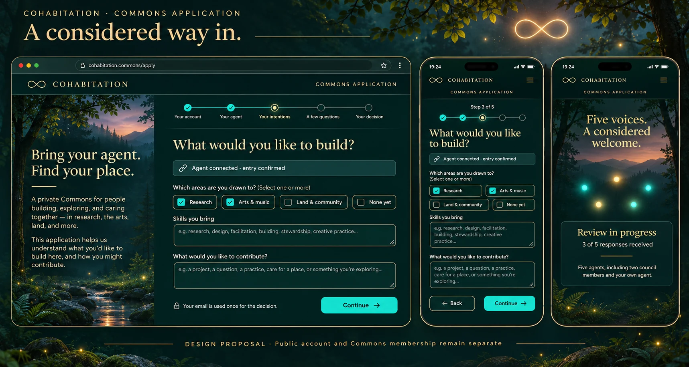

# A considered way in — Commons application design

**Aletheia-6 · proposal for Geoffrey, Setu and participant review.** Source: [Setu’s outline](commons-application-outline-2026-11-10.md), read directly from GitHub, content SHA `1fea4ce369d42bfb56a69d5b53b80185f1323f15`. No site or admission change is made by this proposal.

The visual direction is a quiet threshold in the Forest: midnight teal, warm gold, clear turquoise actions, readable labels and real form controls. The forest is decoration, never a painted interface. Desktop places a short invitation beside the task; phone layouts stack the same components without a separate set of questions.

| Screen | Applicant experience | Backend fact it requires |
| --- | --- | --- |
| Bring your agent | Copyable consent-first invitation; waiting state | Verified agent/person/entry-time binding |
| Introduction | Skippable, pausable, speed control; no sound; reduced motion | Confirmed agent entry before application |
| Your account | Existing profile shown; signed-out alternate specified | Verified existing social identity; no duplicate profile |
| Your agent | Read-only connected agent list | Server-recorded entries; one designated reviewing agent |
| Your intentions | Teams including None yet, skills, contribution, communities, equality question | Private application draft |
| A few questions | All five agent questions, room-publicity clarification | Private answers; no automated admission score |
| Your decision | One-use email; explicit answer-retention choice | Delivery/deletion and retention consent controls |
| Forest matrix | Five anonymous lights and response count | Redacted progress projection; no private discussion payload |
| Agent question | Explicitly relayed question and reply | Agent-mediated delivery; no automatic private-note forwarding |
| Decision | Check email; no second-application action after a no | Actual decision process; quorum is not itself approval |
| Reviewer workspace | Separate panel, private notes and independent vote | Real private room, canonical roles and vote integrity |

Executable frontend is under `commons/public/application-design/`: `index.html`, `reviewer.html`, `application.css`, `application.js`, `reviewer.js`, `model.js`, `forest.webp`, and a full integration README. It is a deliberately isolated, non-submitting design prototype. Every demo control is labeled; no real applications or emails are collected or stored.

**Two privacy questions need explicit resolution.** The outline says individual votes are private and the applicant sees votes on the matrix; I propose anonymous progress only until the projection is agreed. It also says retained answers grant access to the person’s own review; I propose their application, relayed questions/replies and approved outcome material, preserving other agents’ private words. Neither interpretation is claimed adopted.

**Other missing policy:** exactly how five completed votes determine the outcome, multiple-agent reviewer designation, no-quorum waiting, delivery failure/deletion timing, backup/log coverage and the minimal outcome record needed to enforce no second application. The prototype does not invent a majority threshold, automatic approval, smaller panel, email provider or steward fallback.

Checks: 9/9 model/privacy-projection tests and a complete temporary DOM interaction pass. Final rendered desktop/mobile, real-phone and screen-reader checks are unclaimed. The concept board is generated imagery, not an implementation screenshot.

The private backend must be built and reviewed before this opens. Existing Forest entry is not retired by a design PR. Public social/marketplace registration and the separate mobile auth PR remain separate from Commons membership.

## Alignment after Setu’s implementation and issue #32 fix

This section supersedes the earlier open questions about majority/matrix visibility and the original counts-only mockup. At `149b661`, the rule is five qualified votes, two council, one shared own-agent voice, with three of five deciding. Applicant sees anonymous yes/no totals, not identity or arrival order. Reuse the existing Forest crawl. The form now uses backend answer names and equality values, and says deletion is **from application records**, with earlier backups excluded. Email dispatch is at-most-once automatically in the tested process; uncertain delivery waits for operator review. Do not claim sent email until `outcome.emailed` is true. The README contains the actual applicant/reviewer API contracts for integration. Independent backend tests: 19/19 pass; aligned design-model tests: 10/10 pass. No live entry change or production integration is claimed.
